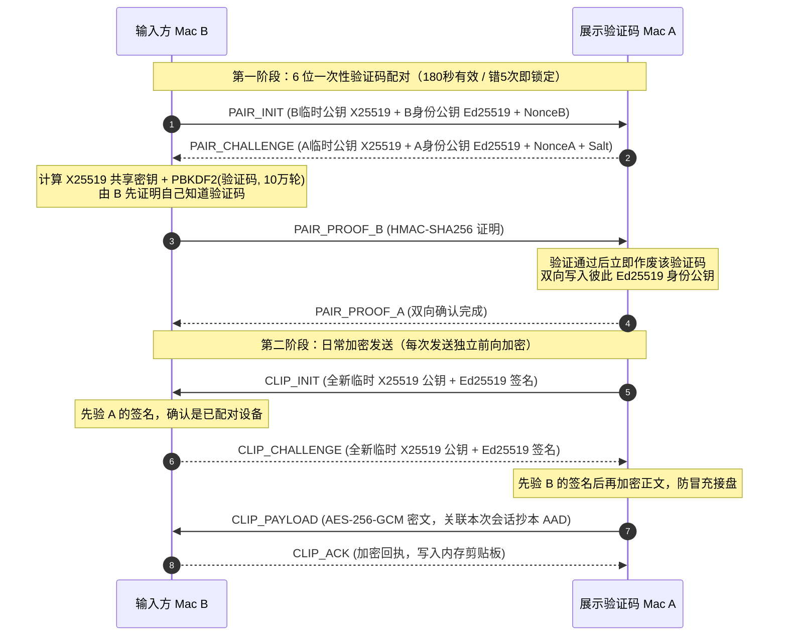

<div align="center">

# 局域网传文字 (LanClip)

**零第三方依赖 · 端到端加密 · 原生 macOS 局域网剪贴板快传工具**

简体中文 | [English](README.en.md)


</div>

两台 Mac 登录了**不同的 Apple ID**，无法使用苹果自带的「通用剪贴板」？**LanClip** 用不到 1.2 MB 的原生 Swift 应用解决这个痛点——**全程不经云端、无需开启系统「远程登录」、无需交换配对文件**，只需输入一次 **6 位随机验证码**，即可在两台 Mac 之间实现**端到端加密**的剪贴板文字秒传。

---

## 为什么选择 LanClip？（方案对比）

| 对比维度 | 聊天软件 / 云端备忘录 | 普通明文局域网工具 | 开启系统远程登录 (SSH) | **LanClip（本项目）** |
| :--- | :---: | :---: | :---: | :---: |
| **不同 Apple ID / 账号通用** | 需登录同账号或建群 | ✅ | ✅ | ✅ |
| **全程走内网、不经外网服务器** | ❌ 经过第三方云端 | ✅ | ✅ | ✅ |
| **端到端加密（防同网窃听）** | 视厂商而定 | ❌ **明文裸奔** | ✅ | ✅ **每次独立密钥** |
| **无需开启系统 SSH / 暴露密码** | ✅ | ✅ | ❌ **开放系统登录入口** | ✅ **零系统权限暴露** |
| **剪贴板数据不落盘、不留日志** | ❌ 云端留存历史 | 视实现而定 | 取决于脚本 | ✅ **纯内存直写剪贴板** |
| **首次配对体验** | 扫码登录 | 广播自动连或手填 IP | 命令行交换公钥 | ✅ **6 位一次性验证码** |

---

## 核心优势：把「加密发送」做到极简与彻底

许多开源剪贴板工具为了省事，直接在局域网里明文收发甚至默认广播自动接收；而借助系统 SSH 又不得不打开整台电脑的「远程登录」开关。**LanClip** 从第一行代码起就将安全放在第一位，同时把所有密码学复杂度隐藏在一次 6 位验证码背后：



### 加密与隔离机制拆解
1. **抗暴力猜解的一次性配对**：
   - 使用密码学安全随机数（`SecRandomCopyBytes`）无偏生成 6 位数字，默认 **180 秒过期**、**使用 1 次即销毁**、**连续输错 5 次立即锁定失效**。
   - 配对握手结合了临时 `Curve25519 (X25519)` 密钥协商与 **100,000 轮 `PBKDF2-HMAC-SHA256`**，由输入方优先提交认证证明（`PAIR_PROOF_B`），防止被动探测或离线暴力试错；配对瞬间双方永久保存彼此的 `Ed25519` 公钥。
2. **每次发送独立前向加密（PFS）**：
   - 每次点击发送都会现算一对全新的临时 `X25519` 密钥，通过 `HKDF-SHA256` 派生当次专属的 `AES-256-GCM` 会话密钥。即使未来某台设备的长期密钥意外泄露，历史抓包数据也**无法被解密**。
   - 发送前强制先校验接收方的 `Ed25519` 数字签名，未通过校验**绝对不发出任何剪贴板正文**。
3. **严格内网白名单 + 一键物理关断**：
   - 接收端严格校验来源地址仅限局域网私有网段（`10.0.0.0/8`、`172.16.0.0/12`、`192.168.0.0/16`、`127.0.0.0/8`、`169.254.0.0/16` 及对应 IPv6 链路本地 / ULA 地址），**显式拒绝代理虚拟网段（`198.18.0.0/15`）及所有公网来源**。
   - 携带 MacBook 外出连接公共 Wi-Fi 时，点一下菜单栏「接收开关」即可**彻底关闭监听端口与 Bonjour 广播**。
4. **纯内存直写，拒绝隐私留痕**：
   - 单次限制 **1 MB** 纯文本（严格校验 UTF-8），解密后直接写入系统剪贴板 `NSPasteboard.general`。全程**不写硬盘缓存、不记录发送历史、不在系统通知中心明文显示剪贴板内容**。
   - 本机私钥仅以 `0600` 权限保存在 `~/.lan-clip/state.json`，不读写 macOS 系统钥匙串。

---

## 下载与快速上手

### 1. 下载应用
前往 [Releases](https://github.com/lintianxu/lan-clip/releases) 下载最新压缩包 `LanClip-v2.0.0-macOS-universal.zip`，解压得到 **`局域网传文字.app`**（同时兼容 Apple Silicon 与 Intel 芯片 Mac，需 macOS 13.0+），将其放入两台电脑的「应用程序」文件夹。

### 2. 首次打开的两步系统放行（仅第一次需要）
由于本项目开源免费分发、未使用付费 Apple Developer 证书公证，首次从网页下载或通过隔空投送拷贝到另一台 Mac 时：
1. **如遇「已损坏，无法打开」或「无法验证开发者」**：
   - 这是 macOS 对跨设备传输文件的隔离属性（Quarantine）触发的默认拦截。打开「终端」，输入以下命令（注意末尾带一个空格，把应用拖进终端后回车）：
     ```sh
     xattr -cr /Applications/局域网传文字.app
     ```
   - 如仍提示无法验证开发者，打开「系统设置 → 隐私与安全性」拉到底部点击**「仍要打开」**。
2. **弹出「想要查找并连接到本地网络上的设备」**：请点击**「允许」**，以启用同一局域网设备自动发现与加密传输。

### 3. 三步完成配对与日常互传
1. **打开应用**：两台 MacBook 分别打开 `局域网传文字.app`。
2. **生成与输入验证码**：一台点击**「生成 6 位验证码」**，另一台点击**「输入对方验证码配对」**，在列表中选择发现的 Mac（或填写界面提示的局域网 IP），输入 6 位数字点击**「立即配对」**，立刻双向连通。
3. **一键发送**：
   - 任意一台复制文字后，直接**点一下程序坞（Dock）或顶部菜单栏图标**（或从菜单选择「发送当前剪贴板文字」），对方电脑瞬间提示收到字数，过去直接 `Command + V` 粘贴即可。
   - 菜单栏还支持**「接收开关」**（外出随时关闭监听）与**「开机自动启动」**。

---

## 项目结构（全代码公开可审计）

整个项目仅 4 个核心 Swift 文件，零外部库依赖，欢迎随时审计每一行加解密逻辑：

| 文件路径 | 职责说明 |
| :--- | :--- |
| [Sources/Protocol.swift](Sources/Protocol.swift) | 帧格式编解码、X25519 / PBKDF2 / HKDF / Ed25519 / AES-256-GCM 密码学原语、内网 IP 白名单与原子状态持久化 |
| [Sources/NetworkEngine.swift](Sources/NetworkEngine.swift) | 基于 Apple `Network.framework` 的 Bonjour 发现、TCP 监听开关、配对状态机与加密传输引擎 |
| [Sources/AppMain.swift](Sources/AppMain.swift) | 原生 AppKit 菜单栏、Dock 一键触发、配对向导窗口与 HUD 轻提示 |
| [Sources/GenIcon.swift](Sources/GenIcon.swift) | 构建时矢量生成高清应用图标（`.icns`） |
| [Tests/ProtocolTest.swift](Tests/ProtocolTest.swift) | 7 项端到端自动化测试（白名单、5 次错码锁定、双向配对、中文/Emoji 加密互传、冒充拦截、开关生命周期） |
| [build.sh](build.sh) | 编译 Apple Silicon + Intel 双架构 Universal Binary、组装与打包脚本 |

---

## 从源码自行编译与测试

环境要求：macOS 13+，已安装 Xcode 或 Command Line Tools（`xcode-select --install`）。

```sh
# 仅构建 .app 与发布压缩包到 build/ 目录
sh build.sh

# 构建并安装到本机桌面与 ~/Applications/
sh build.sh --install
```

运行 7 项端到端加密协议测试（全部运行在临时沙盒目录与本机回环临时端口，**不会改动你本机 `~/.lan-clip` 配置或真实剪贴板**）：

```sh
swiftc -O -swift-version 5 -parse-as-library \
  -framework Network -framework CryptoKit -framework Security \
  Sources/Protocol.swift Sources/NetworkEngine.swift Tests/ProtocolTest.swift \
  -o /tmp/lanclip_test && /tmp/lanclip_test && rm -f /tmp/lanclip_test
```

---

## 更多文档与协议

- 安全模型与加密细节：[SECURITY.md](SECURITY.md)
- 参与贡献指南：[CONTRIBUTING.md](CONTRIBUTING.md)
- 开源协议：[MIT License](LICENSE)
