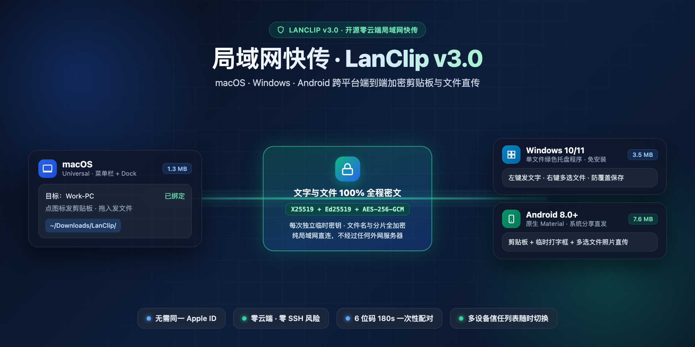
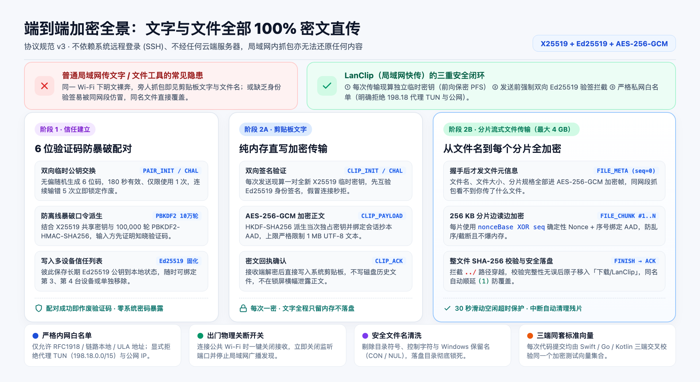
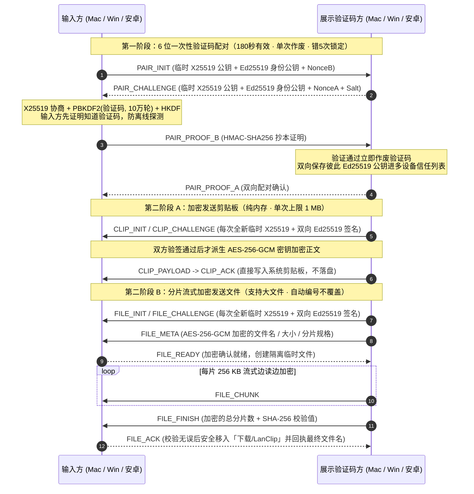
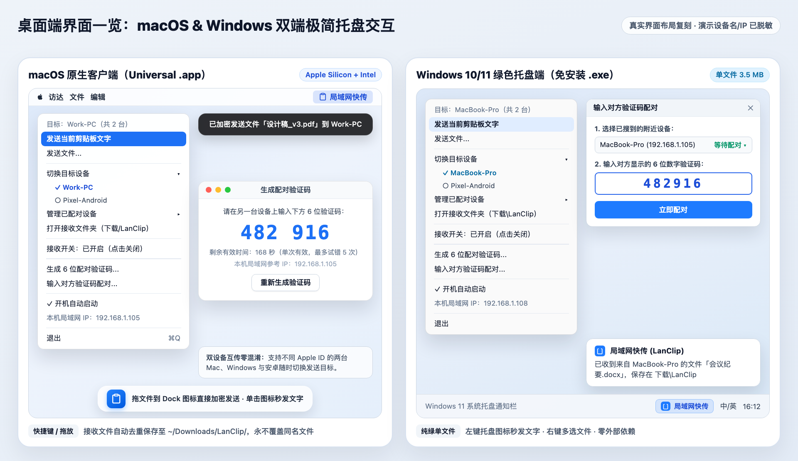

<div align="center">

# 局域网快传 (LanClip)

**macOS · Windows · Android 跨平台局域网端到端加密剪贴板与文件快传工具**

简体中文 | [English](README.en.md)


<br/><br/>



</div>

两台 Mac 登录**不同的 Apple ID**、或者电脑与 Windows / 安卓手机之间想快速互传文字、照片和大文件，又不想把私人内容传上微信或第三方网盘？

**LanClip（局域网快传）** 是专为跨设备场景打造的极简开源工具——**零云端服务器、无需开启系统「远程登录」、无需交换繁琐的密钥文件**。只需要输入一次 **6 位随机验证码**，即可把家里的 Mac、Windows 电脑和安卓手机互相绑进信任设备列表，随时一键**端到端加密互传剪贴板文字和任意文件**。

---

## 为什么选择 LanClip？（安全与体验对比）

| 对比维度 | 微信 / 聊天工具 / 云备忘录 | 普通明文局域网工具 | 开启系统远程登录 (SSH) | **LanClip（本项目）** |
| :--- | :---: | :---: | :---: | :---: |
| **macOS / Windows / 安卓全打通** | 需登录同账号或建群 | 视客户端而定 | 手机与 Windows 体验差 | ✅ **三端原生互通** |
| **全程走内网、不经外网服务器** | ❌ 经过第三方云端 | ✅ | ✅ | ✅ **纯局域网点对点** |
| **文字传输是否加密** | 视厂商而定 | ❌ **局域网明文裸奔** | ✅ | ✅ **每次独立密钥加密** |
| **文件传输是否也全程加密** | 视厂商而定 | ❌ **多为明文或仅防外网** | ✅ | ✅ **文件名/内容/校验全加密** |
| **无需开启系统 SSH / 暴露密码** | ✅ | ✅ | ❌ **开放系统登录权限** | ✅ **零系统终端/文件权限** |
| **防同名文件误覆盖 & 剪贴板留痕** | ❌ 云端长期留存 | 视实现而定 | 取决于脚本 | ✅ **文字纯内存 / 文件自动重命名** |

---

## 核心优势：文字与文件全部「端到端加密发送」

> **明确回答常见疑问：发文件也是 100% 端到端加密吗？**
> **是的！** 无论是几十个字的剪贴板文本，还是几 GB 的视频和照片，**LanClip** 从握手第一包开始就启用独立的临时前向加密——**不仅每一块文件内容密文传输，连文件名、文件大小、SHA-256 完整性校验码和接收回执也全部加密且受完整性保护**。局域网里同一 Wi-Fi 下的其他设备即使抓包，也看不到你传了什么字、传了什么文件。

<p align="center">
  
</p>

<details>
<summary>点击展开底层协议交互时序图 (Mermaid)</summary>



</details>

### 六道安全与工程防线
1. **每次传输独立前向加密（PFS）**：每次发文字或发文件都会现算一对全新的临时 `Curve25519 (X25519)` 密钥，再通过 `HKDF-SHA256` 派生当次专属 `AES-256-GCM` 会话密钥。发送前必须先通过对方 `Ed25519` 身份签名校验，否则直接拦截，绝不泄露任何数据。
2. **分片流式防爆内存与防重放**：大文件按 **256 KB** 分片流式读写加密，绝不把大文件整块塞进内存；每片绑定严格递增序号与关联会话抄本的确定性 Nonce，防乱序、防篡改、防截断。
3. **路径穿越拦截 + 自动去重不覆盖**：接收文件名严格剔除路径分隔符（`../`、`..\`）、控制字符与 Windows 保留设备名（如 `CON`、`NUL`），强制限制仅写入各自系统「下载 → LanClip」专属目录；先写临时文件并校验整文件 `SHA-256` 成功后才原子改名落盘，同名文件自动顺延为 `文件名 (1).扩展名`，**永不覆盖已有文件**。
4. **抗暴力猜解一次性配对**：`SecRandomCopyBytes` / `SecureRandom` / `crypto/rand` 无偏生成 6 位数字，180 秒过期、用过即焚、连续输错 5 次立即锁定销毁；密钥派生经过 **100,000 轮 `PBKDF2-HMAC-SHA256`**。
5. **严格局域网白名单 + 物理关断开关**：接收端强制校验来源地址仅限内网私有网段（`10.0.0.0/8`、`172.16.0.0/12`、`192.168.0.0/16`、`127.0.0.0/8`、`169.254.0.0/16` 及 IPv6 `::1`、`fe80::/10`、`fc00::/7`），**显式拒绝代理 TUN 网段（`198.18.0.0/15`）及一切公网来源**；外出连公共 Wi-Fi 时一键关掉「接收开关」即可彻底释放端口与广播。
6. **文字纯内存直传**：剪贴板文字严格校验 UTF-8 与 1 MB 上限后直写系统剪贴板，不写磁盘日志、不在系统锁屏通知或横幅里明文显示剪贴板内容。

---

## 三端体验与界面预览

| 平台 | 形态与体积 | 核心操作 | 收到文件去向 |
| :--- | :--- | :--- | :--- |
| **macOS (13+)** | 原生双架构 Universal `.app`（约 1.3 MB） | 顶部菜单栏 + Dock（**点 Dock 图标发文字，把文件拖到图标上直接发文件**） | `~/Downloads/LanClip/` |
| **Windows (10/11)** | 单文件绿色托盘程序 `.exe`（约 3.5 MB，免安装） | 右下角系统托盘（左键单击发剪贴板，右键选文件 / 切设备 / 开关接收） | `Downloads\LanClip\` |
| **Android (8.0+)** | 原生 Material 安装包 `.apk`（约 7.6 MB） | 主页一键发剪贴板 / 选文件照片 / **临时打字框** / **系统「分享」菜单直发** | 系统「下载/LanClip」 |

<p align="center">
  
  <sub>桌面端（macOS / Windows）菜单栏、托盘交互与 6 位码配对预览（按 v3.0.0 真实界面复刻，演示设备名与内网 IP 已脱敏）</sub>
</p>

<p align="center">
  
  <sub>Android 端主页（剪贴板发送 / 多选传文件 / 临时打字框 / 内存历史）与系统「分享」直发预览（按 v3.0.0 真实布局复刻）</sub>
</p>

---

## 下载与快速上手

### 1. 下载对应平台安装包
前往 [Releases](https://github.com/lintianxu/lan-clip/releases) 下载对应设备的文件（均由 GitHub Actions 自动测试并从源码构建发布）：
- **Mac**：`LanClip-v3.0.0-macOS-universal.zip`（解压后把 **`局域网快传.app`** 拖入「应用程序」）
- **Windows**：`LanClip-v3.0.0-Windows-x64.exe`（免安装，双击即运行到右下角托盘）
- **安卓手机**：`LanClip-v3.0.0-Android.apk`（直接点击安装）

### 2. 首次打开的各平台系统提示（仅第一次需要）
- **macOS**：未购买付费开发者签名，如遇浏览器下载或隔空投送触发“已损坏”或“无法验证开发者”，在终端执行一次：
  ```sh
  xattr -cr /Applications/局域网快传.app
  ```
  并在弹出「想查找并连接到本地网络上的设备」时点击**「允许」**。
- **Windows**：如弹出 Microsoft Defender SmartScreen 提示，点**「更多信息 → 仍要运行」**；如弹出 Windows 防火墙提示，勾选专用网络并点**「允许访问」**。
- **Android**：安装时如提示禁止未知来源，允许本次安装即可；开启接收开关时会在通知栏显示一条安静的“加密接收中”常驻提醒，避免系统后台清理导致电脑发文件连不上手机。

### 3. 三步配对多台设备
1. 在需要互传的设备上打开软件，保持连接同一个局域网 / Wi-Fi。
2. 任意一台点击**「生成 6 位验证码」**，另一台点击**「输入对方验证码配对」**，选中搜到的设备（或手填界面上显示的参考局域网 IP），输入 6 位数字即可双向绑定进各自的**信任设备列表**。
3. 以后家里的第 3、第 4 台设备也只需重复一次验证码配对即可加入列表，随时在「切换目标设备」里切换发送对象，也可单独移除某台设备。

---

## 仓库结构与跨端互通校验

仓库内内置了一份三端共用的权威加密校验样本 [protocol/test_vectors.json](protocol/test_vectors.json)，每次构建都会由 **Swift（macOS）**、**Go（Windows）** 与 **Kotlin（Android）** 三端分别验证完全一致：

| 目录 / 文件 | 说明 |
| :--- | :--- |
| [protocol/SPEC.md](protocol/SPEC.md) | 跨平台二进制帧格式、密钥派生、确定性 Nonce 与文件名清洗完整协议规范 |
| [protocol/test_vectors.json](protocol/test_vectors.json) | 三端交叉校验加密标准向量（配对 + 剪贴板 + 分片文件加密全流程） |
| [macos/](macos) | 原生 Swift macOS 客户端源码、10 项测试与 Universal 构建脚本 |
| [windows/](windows) | 纯 Go 零 CGo Windows 托盘端源码（Stdlib + 官方 `golang.org/x`）、向量/引擎测试与交叉编译脚本 |
| [android/](android) | 原生 Kotlin Android 客户端工程（含系统分享接收、临时输入框与 JUnit 向量/引擎测试） |
| [.github/workflows/build-and-release.yml](.github/workflows/build-and-release.yml) | 三端并行自动化测试与打包发布工作流 |

---

## 从源码编译与运行测试

```sh
# 1. macOS 端：运行 10 项协议测试并构建双架构应用
swiftc -O -swift-version 5 -parse-as-library \
  -framework Network -framework CryptoKit -framework Security \
  macos/Sources/Protocol.swift macos/Sources/NetworkEngine.swift macos/Tests/ProtocolTest.swift \
  -o /tmp/lanclip_test && /tmp/lanclip_test && rm -f /tmp/lanclip_test
sh macos/build.sh --install

# 2. Windows 端（在 macOS/Linux/Windows 均可交叉运行测试与构建）
sh windows/build.sh

# 3. Android 端（需 JDK 17 + Android SDK 35 + Gradle 8.10+）
cd android && gradle test && gradle assembleRelease
```

---

## 文档与开源协议

- 安全威胁模型与密钥存储说明：[SECURITY.md](SECURITY.md)
- 参与贡献指南：[CONTRIBUTING.md](CONTRIBUTING.md)
- 开源协议：[MIT License](LICENSE)
